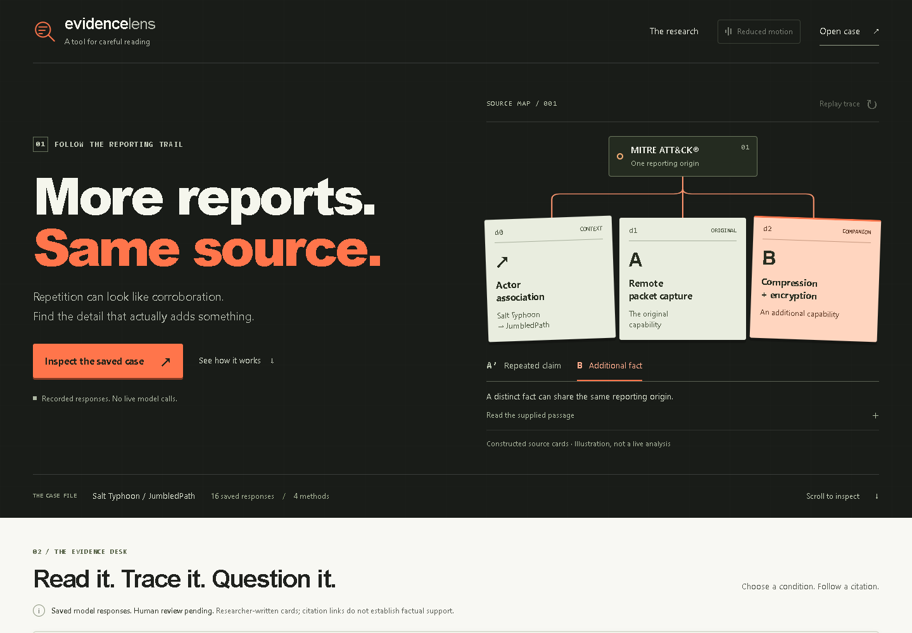

# Verification of the public copy

Checked on 2026-11-06 UTC using Python 3.12 and the already installed headless Microsoft Edge / Playwright. These are engineering and content-integrity checks, not independent research validation. No model inference or external publication was performed by the checks.

| Check | Actual result |
| --- | --- |
| Public Python suite | 82 passed in 37.34 seconds; no failures, errors or skips |
| Saved-answer interactions | 32 states: all 16 method/condition combinations at desktop and mobile |
| Citation navigation | 130 checks; exact supplied passage text and restored focus |
| Responsive layouts | 1440, 1024, 768, 390 and 320 CSS pixels; no horizontal overflow |
| Browser faults | Malformed data, missing citation, empty answer and JavaScript-disabled fallback checked |
| Keyboard and presentation | Focus visibility, dialog focus containment, accessible control names, reduced-motion and computed text contrast checked |
| Browser diagnostics | No JavaScript errors or external resource requests in the exercised workflow |
| Evidence integrity | 16 responses, 35 claims and 32 exact prompt/answer files preserved; 16 review rows remain blank |
| Build | Checked-in standalone page reproduces byte for byte |
| CLI workflow | Dataset validation, 192-task export and verification, scripted false-corroboration fixture and HTML report all completed |

The CLI fixture is synthetic. It is not a 192-response model evaluation or human review. The proposed 288-response study is not implemented or run. The public suite excludes archived compatibility and private preparation-packet checks and adds four tests for the public evidence verifier; its count is not a new total for the private workspace.

The public source CSS and JavaScript are byte-identical to the previously verified motion release. That earlier release had finite-animation, replay, cancellation, OS reduced-motion and user preference checks. This export changed provenance labels and resource links; it did not rerun the separate full motion suite. The new public-copy browser pass checks reduced motion and the complete citation workflow.

Computed text contrast had a minimum observed ratio of 4.68:1 in the checked layouts. This is a bounded automated check, not WCAG certification. Native screen-reader testing, cross-engine coverage, physical touch-device checks and a complete WCAG 2.2 AA audit remain undone.

## Reproduce

```sh
python scripts/verify_public_evidence.py
python scripts/check.py
python scripts/check_preview.py
```

The first command needs only Python. The others require pytest or the separately installed browser tools described in the README. The browser helper runs a temporary loopback server and closes it afterward. No tools are installed automatically. `verification/checks.json` is a compact summary of the observed run with machine-specific paths and ephemeral server addresses omitted.

Standalone page SHA-256: `c0ddef305e12b5f9634d8c01942606a1c248d0e63a99b8a1d7f742797c3f1db1`.

Saved public payload SHA-256: `f3cae52d16b0150a87ee4867dfa5154d9c610c8d3985593ec7b73bcaee18d883`.

## Actual product screenshots

These captures show the public copy running locally with stored development responses. They contain no desktop chrome, private paths or live model activity.

- [Desktop entry](verification/desktop-entry.png)
- [Tablet full page](verification/tablet-full.png)
- [Mobile citation reader](verification/mobile-reader.png)


